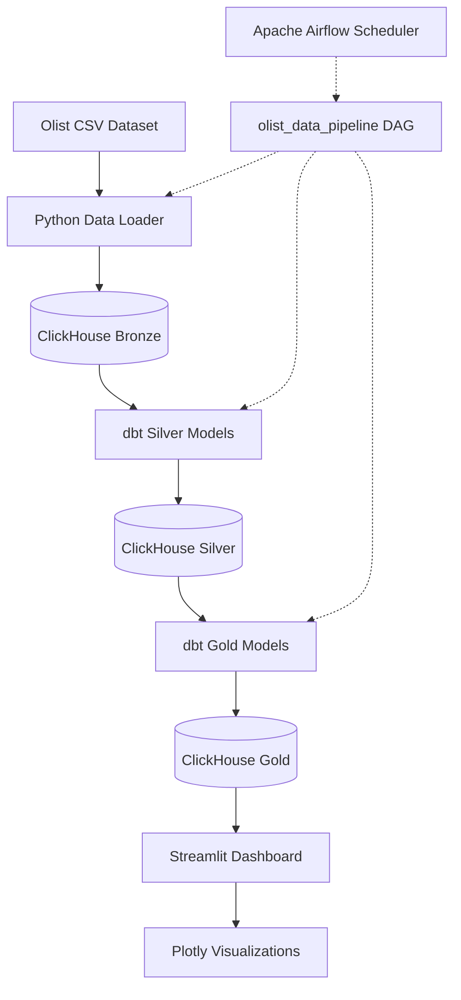

# Olist Data Engineering Pipeline Architecture

## 1. Architecture Overview

This project implements an end-to-end ELT pipeline using
ClickHouse, Python, dbt, Apache Airflow, and Streamlit.

## 2. Data Pipeline Layers

### Bronze Layer
- Source: Olist CSV dataset.
- Ingestion: Python (`04_load_bronze.py`).
- Storage: ClickHouse database `olist_clickhouse`.
- Purpose: Store raw source data.

### Silver Layer
- Transformation: dbt.
- Storage: ClickHouse database `olist_silver`.
- Purpose: Clean, standardize, and prepare data for analytics.

### Gold Layer
- Transformation: dbt.
- Storage: ClickHouse database `olist_gold`.
- Purpose: Provide analytical fact and dimension tables.

## 3. Gold Data Models

### Dimension Tables
- `dim_customers`
- `dim_date`
- `dim_products`
- `dim_sellers`

### Fact Tables
- `fct_orders`
- `fct_order_items`
- `fct_payments`
- `fct_reviews`

## 4. Orchestration

Apache Airflow manages the pipeline using DAG:

`olist_data_pipeline`

Execution sequence:

1. `load_bronze`
2. `dbt_silver`
3. `dbt_gold`

Schedule: Daily at 00:00 Asia/Jakarta.

## 5. Visualization

Streamlit connects to the Gold database and presents:
- Order KPIs and monthly trends.
- Order status distribution.
- Top 10 products.
- Payment method distribution.
- Customer review scores.
- Gold data explorer.

Plotly is used to create interactive charts.

## 6. Technology Stack

| Technology | Responsibility |
|---|---|
| Python | Data ingestion |
| ClickHouse | Data storage and analytics |
| dbt | Data transformation |
| Apache Airflow | Workflow orchestration |
| Docker | Containerization |
| Streamlit | Dashboard |
| Plotly | Visualization |
